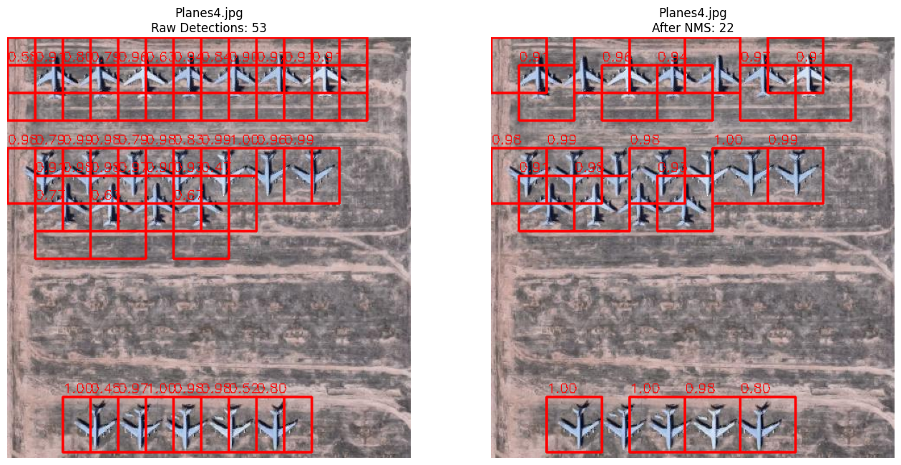

# Airplane Detection in Aerial Imagery with a Sliding-Window CNN

A from-scratch baseline for detecting airplanes in overhead imagery. A small
CNN classifies 64×64 crops as airplane or background, the classifier is slid
across the full image, and non-maximum suppression merges the overlapping
hits into final boxes.



*Left: every window scored above 0.4. Right: after non-maximum suppression.*

## Approach

| Stage | Details |
| --- | --- |
| Data | 729 annotated aerial images, 2,906 airplane bounding boxes |
| Training crops | 64×64 windows at stride 32; positive when IoU with a ground-truth box ≥ 0.5 |
| Class balance | 575 positive and 36,799 negative crops, sampled down to 15 negatives per positive (9,200 crops) and trained with class weights |
| Split | 80% train, 20% validation, stratified, seed 42 |
| Model | 3 convolution blocks (32, 64, 128 filters), global average pooling, dropout 0.4, dense 128, sigmoid output; 109,889 parameters |
| Training | Adam, binary cross-entropy, up to 15 epochs with early stopping on validation loss |
| Inference | Sliding window, score threshold 0.4, non-maximum suppression |

## Results

Figures printed by `Object_Detector_CNN_Based.ipynb`:

| Evaluation | Precision | Recall | F1 |
| --- | --- | --- | --- |
| Crop classification, validation set (1,840 crops, threshold 0.4) | 0.21 | 0.99 | 0.34 |
| Box detection on 100 images (IoU ≥ 0.5) | 0.11 | 0.14 | 0.13 |

The classifier finds almost every airplane crop but raises many false alarms,
and box-level detection is weak. This is a baseline, and the reasons are
mostly structural:

- **Fixed 64×64 boxes.** Predicted boxes cannot change size or shape, so
  larger or smaller aircraft rarely reach IoU 0.5 with the ground truth even
  when the model fires on them.
- **Coarse stride.** A stride of 32 pixels means a window is often not
  centred on the aircraft.
- **No hard-negative mining.** Negatives are sampled at random, so runway
  markings and buildings are under-represented in training.
- **The 100 evaluation images are drawn from the same pool used for training
  crops**, so the detection figures are not a clean held-out estimate.

A detector with box regression (Faster R-CNN, YOLO) would address the first
two points directly and is the natural next step.

## Running it

Both notebooks were written for Google Colab.

1. `Object_Detector_CNN_Based.ipynb` builds the crop dataset, trains the
   classifier and evaluates it. Set `IMG_DIR` and `ANN_DIR` to the image
   folder and the per-image annotation CSVs.
2. `Final_Testing.ipynb` loads a saved model, runs detection on single images
   or a folder, and launches a small Gradio demo. Update the model path in
   the first cell to wherever your trained model is saved.

```bash
pip install -r requirements.txt
```

The dataset and trained weights are not included in this repository.

## License

MIT
