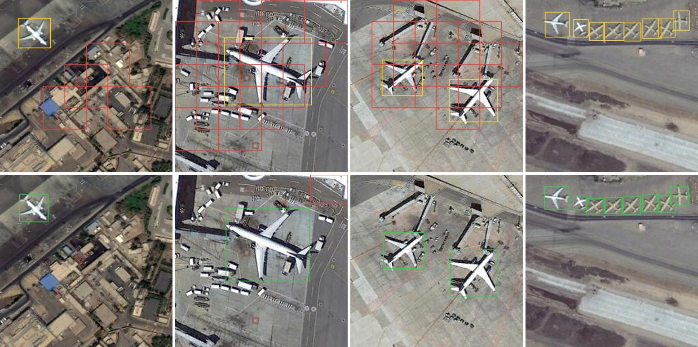
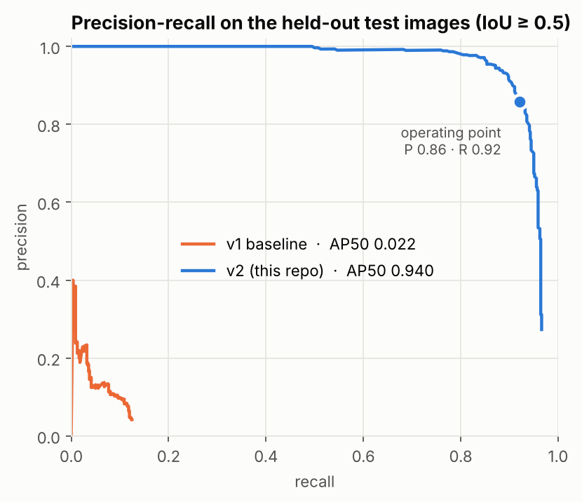
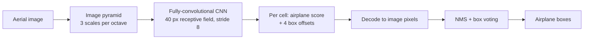
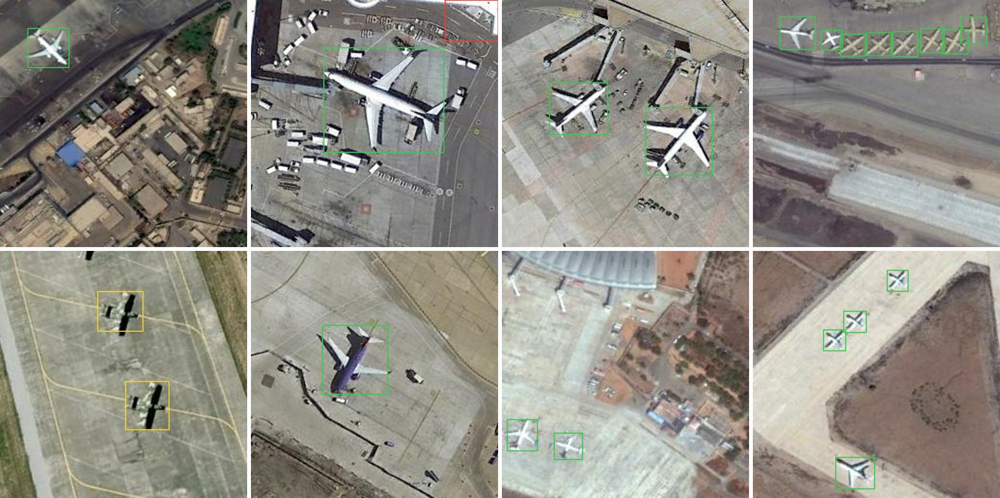
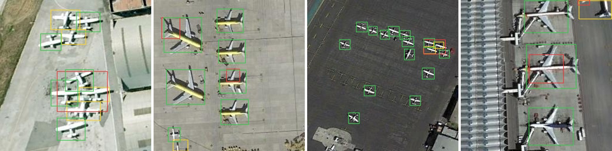
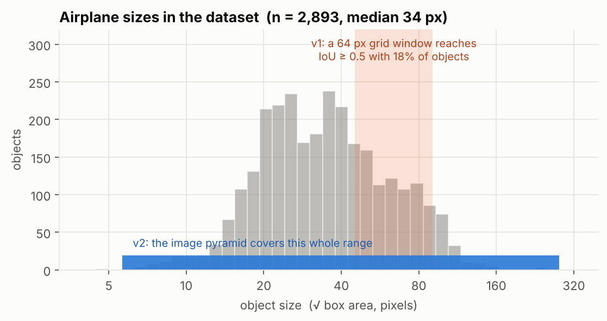
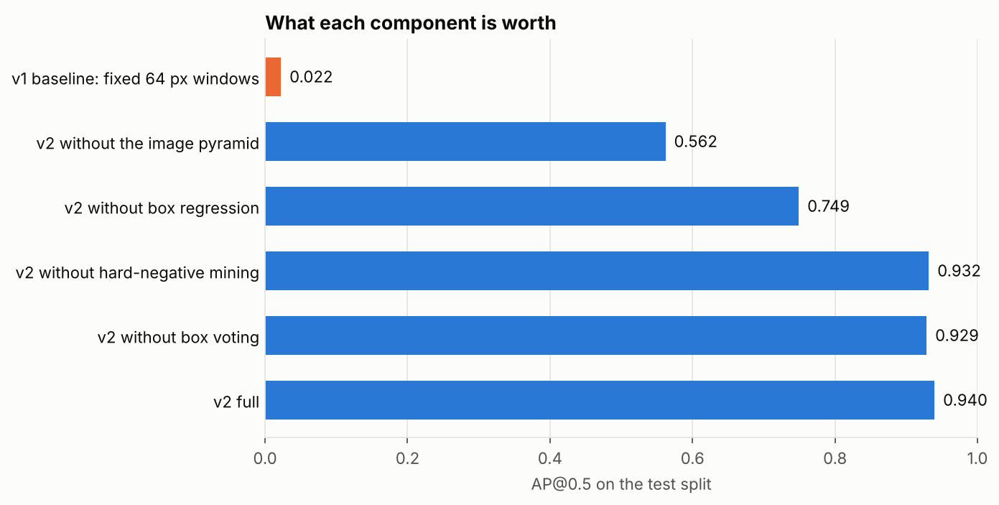

# Airplane detection with a from-scratch fully-convolutional CNN

[](https://github.com/Shahd-M-Elkilany/CNN-Object-Detector-/actions/workflows/ci.yml)


[](LICENSE)

A 217k-parameter CNN, trained from scratch on 511 aerial images with no pretrained weights, that finds
airplanes with **AP@0.5 = 0.94** on held-out test images. It trains and runs on a CPU.

The repository also documents how it got there: the first version of this project scored AP@0.5 = 0.02 under
the same evaluation, and the write-up below explains exactly why, and what each fix was worth.



<sub>Same four test images. **Top:** version 1 (fixed 64 px windows). **Bottom:** this version.
Green = correct detection, red = false alarm, yellow = missed airplane.</sub>

## Results

All numbers are on the **test split**: 110 images and 560 airplanes that were never used for training,
model selection or threshold tuning.

| | AP@0.5 | AP@0.75 | mAP@[.5:.95] | Precision | Recall | F1 |
|---|---:|---:|---:|---:|---:|---:|
| v1 — CNN classifier on fixed 64 px windows | 0.022 | 0.000 | 0.005 | 0.084 | 0.109 | 0.095 |
| **v2 — this repository** | **0.940** | **0.429** | **0.486** | **0.859** | **0.921** | **0.889** |

- AP@0.5 95 % confidence interval (bootstrap over test images): **0.917 – 0.975**.
- Precision / recall / F1 are at the score threshold chosen on the *validation* split (0.80 for v2; the
  original notebook's 0.40 for v1).
- By object size (√area): small < 20 px **0.787** (75 objects) · medium 20–45 px **0.956** (315) ·
  large ≥ 45 px **0.965** (170).
- One test image is a boneyard scene with 206 airplanes, 37 % of all test objects. Without it the model scores
  AP@0.5 0.964 and F1 0.924 on the remaining 109 images, so that scene pulls the headline number down, not up.
- Model: 217,229 parameters, 0.9 MB of weights. Training: 67 minutes on 2 CPU cores. Inference: 0.44 s per 256×256
  tile on the same 2 cores (16 pyramid levels).

<p align="center"></p>

Metrics follow the COCO protocol (greedy matching by score, 101-point interpolated AP) and the implementation
is checked against `pycocotools` in the test suite. Raw reports are in [`results/`](results).

## How it works



1. **One window, one question.** The network sees a 40×40 patch and answers: *is an airplane filling the
   central 24×24 anchor, and where exactly are its edges?* It outputs an objectness logit and four box offsets.
2. **Every window in one pass.** All convolutions are unpadded, so the same weights applied to a whole image
   produce the answer for every stride-8 window at once. A unit test asserts the dense output equals the
   window-by-window output.
3. **Any object size.** The image is resized to up to 17 scales, so airplanes from 8 px to over 280 px each
   land on the anchor at some level.
4. **Training patches.** Positives are jittered windows around each airplane. Negatives are random background
   plus *near misses* — an airplane off-centre or at the wrong scale — which is what teaches localisation.
5. **Hard-negative mining.** After a first training stage the detector is run on the training images; its
   confident false alarms are added to the negative pool and training continues. Two rounds.
6. **Post-processing.** Non-maximum suppression, then each surviving box is replaced by the score-weighted
   average of the boxes it suppressed (box voting).

[`notebooks/walkthrough.ipynb`](notebooks/walkthrough.ipynb) shows each step with pictures.

## More test images



<sub>Eight test images drawn at random (fixed seed). Green = correct, red = false alarm, yellow = missed.</sub>

The four test images with the most mistakes (scenes with over 40 airplanes left out for legibility):



## Why version 1 could not work

<p align="center"></p>

Version 1 ([legacy notebook](notebooks/legacy/Object_Detector_CNN_Based.ipynb)) classified fixed 64×64 crops
on a stride-32 grid and reported the crop itself as the box. Re-running it faithfully
([`baseline.py`](src/airplane_detector/baseline.py)) on a clean split shows four problems:

| Problem | Evidence | Fix in v2 |
|---|---|---|
| A 64 px box cannot overlap a 34 px airplane with IoU ≥ 0.5 | Only **18 %** of airplanes are reachable by *any* grid window; measured recall never exceeds 12.5 % | Image pyramid + box regression |
| Train/test leakage | Crops were split at random, and detection was scored on images used for training | Split by image, fixed in [`data/splits.json`](data/splits.json) |
| Reported numbers did not match the run | Abstract: F1 0.53. Saved output of the same notebook: F1 0.13 | Every number in this README is regenerated from `results/*.json` |
| One `model.predict` call per window | About 6 s per image in the notebook log | One forward pass per pyramid level |

## What each component is worth

<p align="center"></p>

| Variant (test split) | AP@0.5 | mAP |
|---|---:|---:|
| v2 full | 0.940 | 0.486 |
| without box voting | 0.929 | 0.472 |
| without hard-negative mining (same 30 epochs) | 0.932 | 0.464 |
| without box regression (anchor used as the box) | 0.749 | 0.237 |
| without the image pyramid (original resolution only) | 0.562 | 0.212 |

The pyramid and box regression carry the result. Hard-negative mining adds only 0.008 AP@0.5 at an equal training
budget, which is inside the confidence interval; its measurable effects are tighter boxes (AP@0.75 0.37 → 0.43)
and better-spread scores (the best validation threshold moves from 0.995 to 0.80).

## Quick start

```bash
git clone https://github.com/Shahd-M-Elkilany/CNN-Object-Detector-.git
cd CNN-Object-Detector-
pip install -e .            # add ".[dev]" for tests, ".[demo]" for the Gradio app

airdet predict path/to/image_or_folder      # uses the released model in models/
```

`predict` writes annotated images and a `detections.json` to `predictions/`. From Python:

```python
import cv2
from airplane_detector.detect import Detector

detector = Detector.load("models/airplane_fcn.weights.h5")
image = cv2.imread("scene.jpg")
result = detector.detect(image, score_threshold=detector.cfg.score_threshold)
print(result.boxes, result.scores)          # [x1, y1, x2, y2] in pixels
```

Reproduce the numbers:

```bash
airdet download                                             # 733 images, 13 MB, checksum-verified
airdet evaluate --split test --out results/test_metrics.json
airdet train --config configs/default.yaml                  # ~70 min on 2 CPU cores
make reproduce                                              # everything, including ablations and figures
python app.py                                               # interactive demo
```

## Repository layout

```
src/airplane_detector/
  config.py      every hyper-parameter, one dataclass
  data.py        download, annotation parsing, cleaning, image-level splits
  sampling.py    pyramid scales, patch extraction, augmentation, negative sampling
  model.py       the network and its loss
  detect.py      multi-scale dense inference, decoding, NMS + box voting
  evaluate.py    AP / precision / recall, size breakdown, bootstrap intervals
  train.py       two-stage training with hard-negative mining, calibration
  baseline.py    faithful port of version 1, for the before/after comparison
  cli.py         the `airdet` command
configs/         default experiment and the no-mining ablation
models/          released weights, config and model card
results/         metric reports behind every number above
scripts/         ablations, figures, notebook builder
tests/           90 unit tests (synthetic data, no download needed)
notebooks/       guided walkthrough, plus the original v1 notebooks
```

## Testing

```bash
pip install -e ".[dev]" && pytest && ruff check .
```

The suite runs in about 10 seconds without the dataset. It covers the claims the method depends on: dense
output equals sliding-window output, tiled inference equals single-pass inference, grid cells decode to the
right pixels, augmentation moves boxes with the pixels, splits are disjoint and deterministic, and the metric
code agrees with `pycocotools` to six decimals. CI runs it on Python 3.10 and 3.12 and checks that the released
model loads.

## Limitations

- **Loose boxes.** AP drops from 0.94 at IoU 0.5 to 0.43 at IoU 0.75. A single square anchor on a stride-8 grid
  finds airplanes reliably but does not outline them tightly.
- **Small and dark aircraft.** AP@0.5 is 0.79 below 20 px, and the two dark, camouflaged aircraft in the
  examples above are missed entirely.
- **Crowded aprons.** Tightly parked aircraft are sometimes merged into one box or split, and the tail or
  wing of a large aircraft can be reported as a second, smaller one.
- **One dataset, one seed.** 733 images from a handful of airports; the confidence interval covers test-set
  sampling but not training randomness, and nothing here measures transfer to other sensors or resolutions.
- **Label noise.** Some visible airplanes are unlabelled, and some boxes appear to group several aircraft. These count
  against the model and are also mined as "hard negatives".
- **No pretrained reference.** A fine-tuned modern detector would likely do better; that comparison has not
  been run here.

Next steps, in order of expected value: rotated or aspect-ratio anchors for tighter boxes, a feature pyramid
instead of an image pyramid for speed, repeated seeds, and a pretrained-detector reference on the same split.

## Data and licence

The images and annotations come from the *Airplanes* set distributed with
[1297rohit/RCNN](https://github.com/1297rohit/RCNN) (Apache-2.0). They are downloaded on demand at a pinned
commit and are not redistributed here. Cleaning rules and split statistics are in [`docs/DATA.md`](docs/DATA.md);
intended use and caveats of the released weights are in [`models/MODEL_CARD.md`](models/MODEL_CARD.md).

Code and weights: MIT, see [LICENSE](LICENSE).

## References

- Sermanet et al., *OverFeat: Integrated Recognition, Localization and Detection using Convolutional Networks*, 2014 — dense sliding-window inference.
- Girshick et al., *Rich feature hierarchies for accurate object detection and semantic segmentation*, 2014 — box parameterisation.
- Ren et al., *Faster R-CNN*, 2015 — anchor labelling rules.
- Felzenszwalb et al., *Object Detection with Discriminatively Trained Part-Based Models*, 2010 — hard-negative mining.
- Gidaris & Komodakis, *Object detection via a multi-region and semantic segmentation-aware CNN model*, 2015 — box voting.
- Lin et al., *Microsoft COCO: Common Objects in Context*, 2014 — evaluation protocol.
